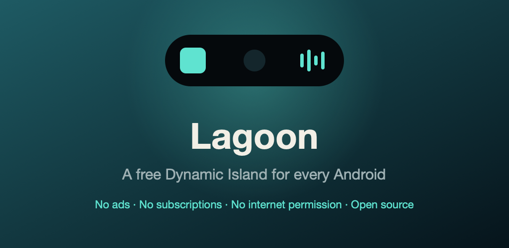
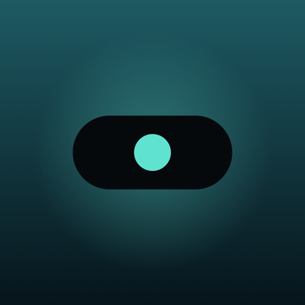
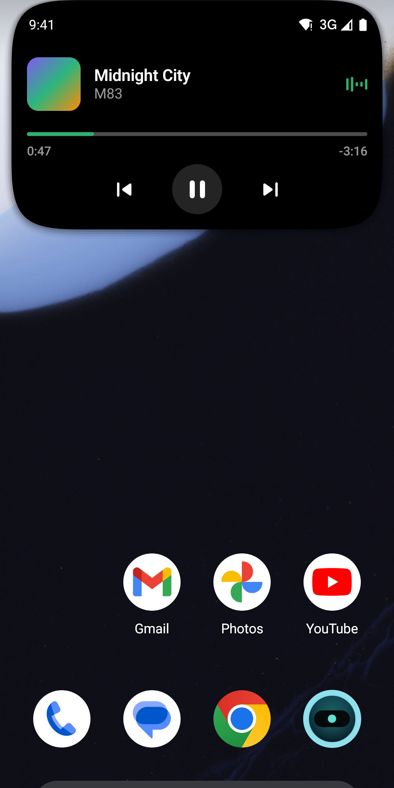
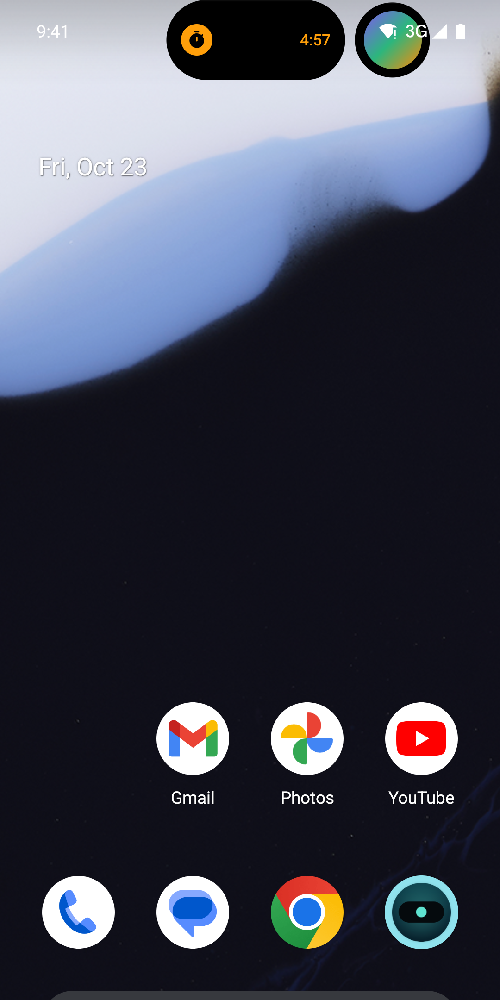
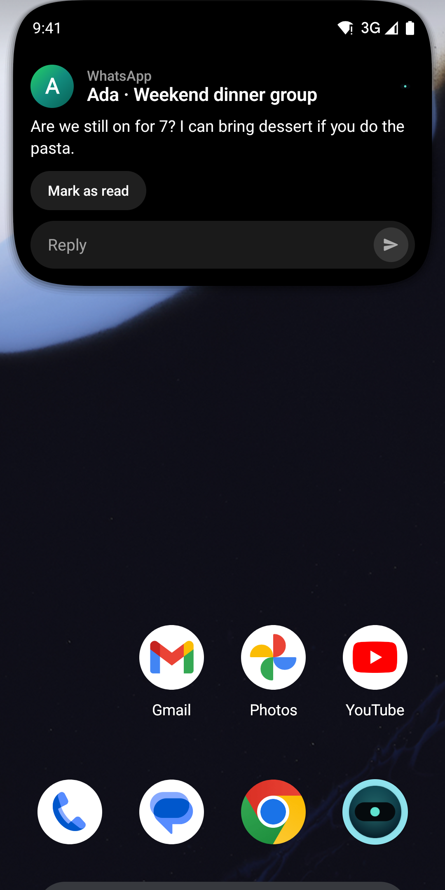
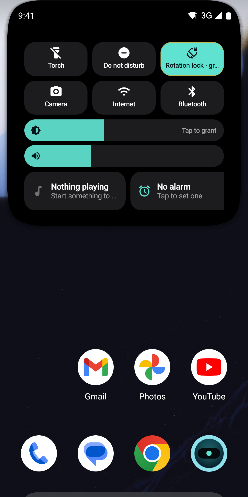
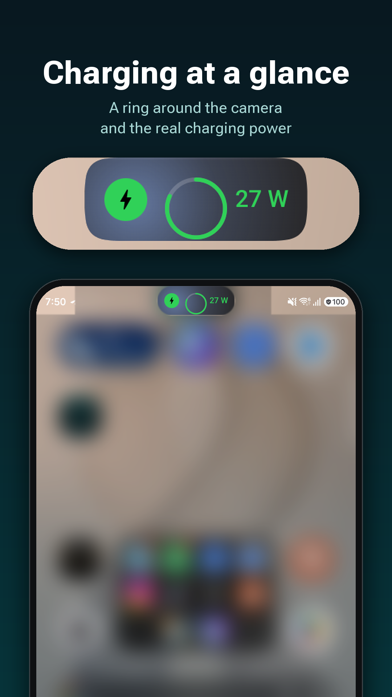
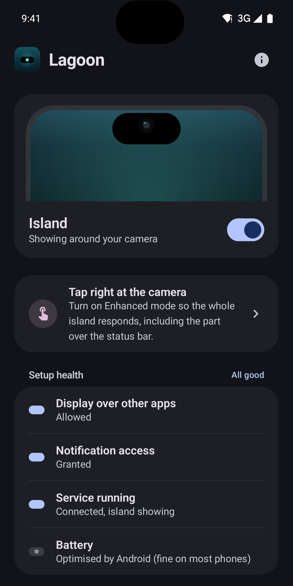
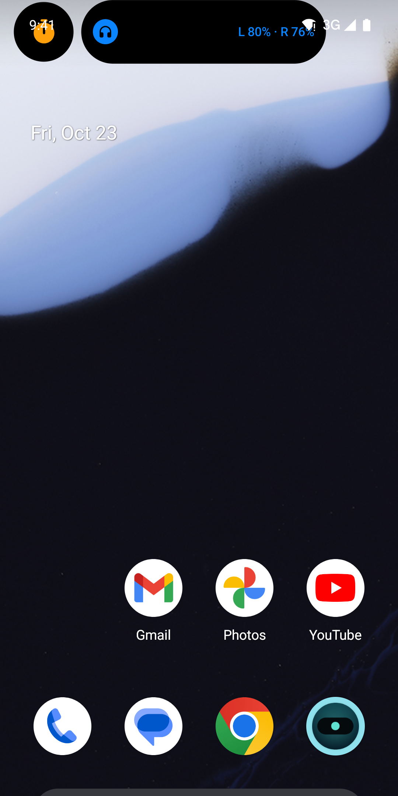
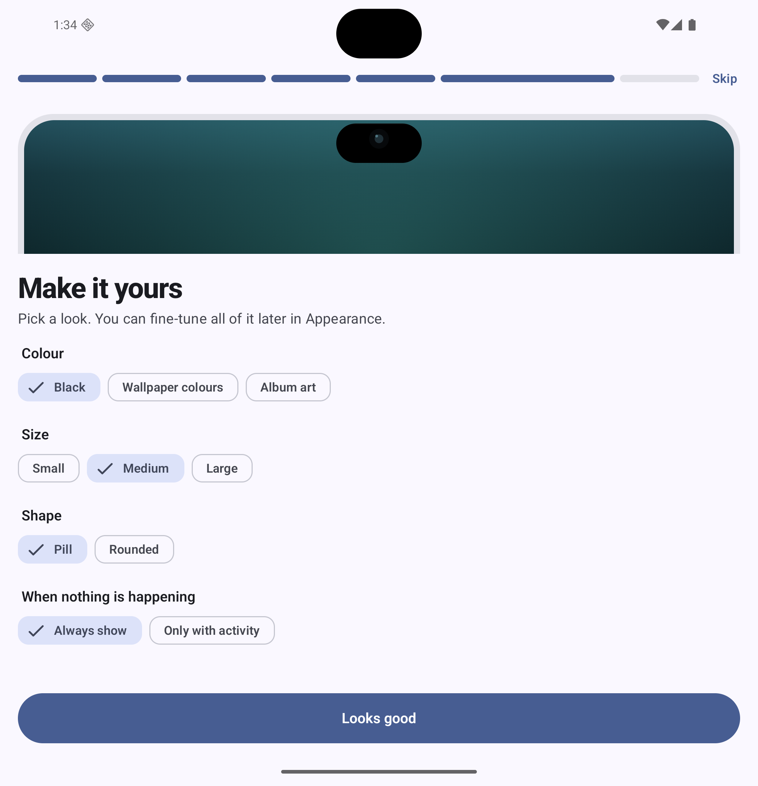

# Lagoon: Google Play store listing

Everything Play Console asks for on **Grow > Store presence > Main store listing**, plus the app-content answers, ready to paste. Images live in `fastlane/metadata/android/en-US/images/` (the same files F-Droid reads).



## 1. App details

| Field | Value |
|---|---|
| App name | Lagoon |
| Package | `com.lagoon.island` |
| Default language | English (United States), en-US |
| Category | Personalization |
| Tags | Customization, Notifications, Productivity |
| Price | Free, no in-app purchases |
| Contains ads | No |
| Website | https://github.com/ashyrr07/lagoon |
| Privacy policy | https://github.com/ashyrr07/lagoon/blob/main/docs/privacy.md |
| Contact email | Your support address (Play shows it publicly) |

## 2. Graphics

| Asset | Size | File |
|---|---|---|
| App icon | 512 × 512 PNG | `images/icon.png` |
| Feature graphic | 1024 × 500 PNG | `images/featureGraphic.png` |
| Phone screenshots | 1080 × 2160 PNG, 7 images | `images/phoneScreenshots/` |
| Tablet / foldable screenshot | 2076 × 2152 PNG | `images/tenInchScreenshots/` |



### Phone screenshots, in upload order

Suggested caption for each screenshot (Play doesn't show captions, but they work as overlay text if you later add a device frame).

| # | Screenshot | Caption |
|---|---|---|
| 1 |  | Your music, around the camera |
| 2 |  | Two things at once: timer and music |
| 3 |  | Read and reply without leaving your app |
| 4 |  | Quick controls one tap away |
| 5 |  | Charging power at a glance |
| 6 |  | Simple setup, honest permissions |
| 7 |  | Earbuds battery when they connect |

### Foldable / tablet screenshot



*Make it yours: colour, size and shape on first launch (unfolded foldable).*

## 3. Store texts

### Title (30 characters max)

```
Lagoon
```

### Short description (80 characters max)

| Language | Text |
|---|---|
| English | A free Dynamic Island for any Android. No ads, no network, open source. |
| Русский | Бесплатный Dynamic Island для любого Android. Без рекламы, без интернета. |
| Deutsch | Kostenlose Dynamic Island für jedes Android. Ohne Werbung, ohne Internet. |
| Français | Une Dynamic Island gratuite pour tout Android. Sans pub, sans Internet. |
| Español | Una Dynamic Island gratis para cualquier Android. Sin anuncios ni internet. |

### Full description (4000 characters max)

English (2,641 characters). The Russian version (2,836 characters) is in `fastlane/metadata/android/ru/full_description.txt`. For German, French and Spanish, Play shows the English text until you add translations.

```
Lagoon turns the camera cutout on your phone into a Dynamic Island: a small black pill that wraps the camera and shows what matters right now, then gets out of the way.

What it shows
• Music: album art, title and artist, play/pause, next and previous, a seek bar. Tap to open the player.
• Calls: who is calling with answer and decline, then a call timer and hang up.
• Timers and stopwatches from your Clock app, plus the next alarm.
• Charging: battery level and charging power when you plug in, low and full battery alerts.
• Earbuds and other Bluetooth devices connecting, with left, right and case battery where the device reports it.
• Turn-by-turn navigation from Google Maps or Waze, and live progress (deliveries, rides, downloads) on Android 16.
• Notifications from the apps you choose, with the full text, actions and inline reply when expanded.

Quick controls
Tap the idle island for a control deck you arrange yourself: torch, Do Not Disturb, rotation lock, brightness and volume sliders, Wi-Fi and Bluetooth panels, camera, app shortcuts, a built-in timer and small widgets.

Make it yours
On first launch you pick a colour (black, wallpaper colours or album art), size, shape and whether the island stays visible when nothing is happening. Later you can fine-tune everything: exact position, width, ring, roundness, gestures and animation speed.

Fits every phone
Lagoon reads the camera cutout from the system and lets you adjust it by hand, so it fits a centred hole, a corner hole or a notch on any brand. On foldables it follows you between the cover screen and the inner screen.

Five languages
English, Русский, Deutsch, Français and Español, switchable inside the app.

Private by design
Lagoon has no INTERNET permission. It cannot send anything anywhere: no analytics, no crash reporting, no accounts, no ads. Notification access is used only to show your notifications and media on the island. The source code is public under the GPL-3.0 licence.

Two modes
• Setup asks for "Display over other apps", Notification access and Enhanced mode.
• Enhanced mode is switched on during setup, after a clear explanation and your consent. It uses an accessibility service so the whole island is tappable, including the part over the status bar, the island can appear on the lock screen, and the control deck can take screenshots, lock the screen or open recents. The service never reads screen content. You can turn it off at any time in Accessibility settings.

Lagoon is free, has no paid tier and never will. If something does not work on your phone, open an issue on GitHub with your device model and Android version.
```

> The Play build (`play` flavor) includes Enhanced mode and setup requires it, so file the accessibility declaration (section 10 of `docs/play-declarations.md`) with the first release.

### Release notes for version 0.1.0 (500 characters max)

```
First public release.
• Island around the camera on any phone, with manual calibration.
• Music, calls, timers, charging, earbuds, navigation and notifications.
• Control deck with quick toggles, sliders, shortcuts and widgets.
• Style picker on first launch; size and roundness.
• Foldable support; five languages.
• No INTERNET permission, no ads, GPL-3.0.
```

## 4. App content answers (Policy > App content)

| Section | Answer |
|---|---|
| Privacy policy | The URL above |
| Ads | No, the app contains no ads |
| App access | All functionality is available without special access (no login) |
| Content rating | Utility; no violence, sexuality, language, controlled substances, gambling or user-generated content shared with others. Expected rating: Everyone / PEGI 3 |
| Target audience | 18 and over only (keeps Lagoon out of the Families programme, which forbids notification-listener and accessibility use) |
| News app | No |
| Data safety | No data collected and no data shared. Lagoon has no internet permission; notification content is processed on the device only and never stored or transmitted |
| Foreground service | Not used in 0.1.0 (no `FOREGROUND_SERVICE` permission) |
| Accessibility API | Declared in the Play build; required at setup. Paste section 10 of `docs/play-declarations.md` and attach the video |

Full paste-ready text for each declaration, including the notification-listener explanation for reviewers, is in [docs/play-declarations.md](play-declarations.md).

## 5. Before you press "Send for review"

1. Create the upload keystore and build the Play bundle (steps in [docs/release.md](release.md)):

   ```bash
   ./gradlew bundlePlayRelease
   ```

2. Upload `app/build/outputs/bundle/playRelease/app-play-release.aab` to a **Closed testing** track first. New personal developer accounts need at least 12 testers opted in for 14 days in a row before production access is granted.
3. Fill in the store listing from sections 1 to 3, the app content answers from section 4, and attach the images.
4. Add the German, French and Spanish full descriptions later if you want those stores fully translated. The app itself is already translated.
